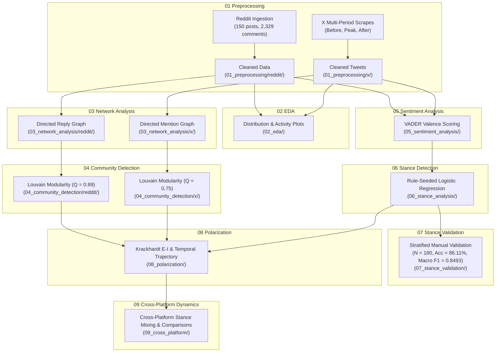

# CJP Online Discourse Analysis

## Overview

This project investigates **echo chambers, structural homophily, and opinion polarization** in online discourse.

The central question is:

> **Does a platform itself exhibit a dominant viewpoint, or do multiple smaller echo-chamber-like communities emerge within the same platform?**

The **CJP–NEET protest movement** is used as a case study, with public discourse from **X (Twitter) and Reddit** analyzed across interactions, communities, sentiment, and stance.

Rather than assuming that a community is an echo chamber because its members share similar opinions, the project examines **what people say, what stance they take, who they interact with, how communities form, and whether those communities interact across their boundaries.**

---

## Analysis Pipeline



### Network & Community Analysis

Interaction networks are constructed for X and Reddit, followed by **Louvain community detection** to identify groups with stronger internal interaction patterns.

These are treated as **structural interaction communities**, rather than automatically being labelled ideological groups.

### Sentiment & Stance

Two separate dimensions are analyzed:

* **Sentiment** — emotional tone of the content (scored via VADER).
* **Stance** — Pro-CJP, Anti-CJP, or Neutral toward the movement.

Target stance is modeled via **TF-IDF + Logistic Regression trained on rule-seeded labels, followed by independent stratified manual validation** ($N = 180$, Accuracy = $86.11\%$, Macro F1 = $0.8493$, Weighted F1 = $0.8598$).

This distinction helps separate emotional expression from actual position toward the topic.

### Echo Chamber & Polarization

The **Krackhardt E-I Index** measures the balance between internal and external interactions:
$$EI = \frac{E - I}{E + I}$$
where $I$ is internal edge weight within a community and $E$ is external edge weight connecting that community to other communities.

Louvain communities show inward concentration ($EI = -0.7547$ on X, $-0.9381$ on Reddit). Note that Reddit's network structure is heavily influenced by thread-based reply dynamics, reflecting **greater structural inward concentration in this network representation** rather than inherently higher social insularity.

Cross-stance interaction analysis further examines whether users primarily interact with users holding the same stance or engage across stance boundaries. The interaction matrices show that **Anti-CJP participants direct over 64% of their known-stanced outgoing interactions on X and over 70% on Reddit toward Pro-CJP targets. This provides evidence against completely isolated echo-chamber-like interaction, while substantial within-group interaction remains.**

### Temporal Analysis

X discourse is examined across three periods:

**Before → Peak → After**

This allows changes in interaction, stance, and network structure to be examined over time.

---

## Repository Structure

Outputs are organized by **analysis stage first**, making it clear which part of the pipeline produced each dataset, metric, or visualization.

```
csma_prj/
│
├── dataset/                                   # Raw Ingested Data
│   ├── reddit_datasets/                       # Targeted Reddit posts & comments
│   └── x/                                     # X multi-period CSVs (Before, Peak, After)
│
├── scripts/                                   # Modular Analysis Pipeline
│   ├── reddit/
│   │   └── csma_pipeline.py                   # Reddit data ingestion & preprocessing
│   ├── x/
│   │   └── x_pipeline.py                      # X data ingestion & preprocessing
│   ├── community_detection.py                 # Louvain community detection, modularity & interactive PyVis graphs
│   ├── sentiment_analysis.py                  # VADER valence sentiment scoring & Dunn post-hoc statistics
│   ├── stance_analysis.py                     # Target-specific stance classification & contingency analysis
│   ├── validate_stance_classifier.py          # Independent stratified manual validation
│   └── polarization_metrics.py                # Krackhardt E-I Index, stance mixing matrices & temporal trajectory
│
├── output/                                    # Generated Artifacts organized by analysis stage
│   ├── 01_preprocessing/                      # Cleaned posts, comments, tweets (Reddit / X)
│   ├── 02_eda/                                # Volume, depth, top users, hashtags & phase engagement plots
│   ├── 03_network_analysis/                   # Directed edges & canonical node lists (Reddit / X)
│   ├── 04_community_detection/                # Louvain modularity summaries, static plots & PyVis HTML graphs
│   ├── 05_sentiment_analysis/                 # VADER scores, community distributions, Dunn post-hoc tests
│   ├── 06_stance_analysis/                    # 3-class target stance predictions, phase summaries & plots
│   ├── 07_stance_validation/                  # Stratified manual validation sample (N=180), metrics & confusion matrix
│   ├── 08_polarization/                       # Krackhardt E-I index tables & temporal trajectories (X / Reddit)
│   └── 09_cross_platform/                     # Cross-platform comparisons, heatmaps & stance mixing matrices
│
├── docs/                                      # Project Documentation & Reports
│   ├── BRIEF_PROGRESS_REPORT.md               # Mid-Term Evaluation Progress Report
│   ├── REVISED_PROJECT_TIMELINE.md            # Progress vs. Plan & Gantt chart
│   └── UPDATED_SYNOPSIS.md                    # Research questions, architecture & methodology
│
├── run_demo.py                                # Master end-to-end execution & verification harness
├── README.md                                  # Repository layout & project guide
└── .gitignore                                 # Git noise hygiene
```

---

## Execution Instructions

To execute the complete analysis pipeline and verify all project assets:

```bash
python run_demo.py
```

To run individual pipeline stages independently:

```bash
# Data Ingestion & Preprocessing
python scripts/reddit/csma_pipeline.py
python scripts/x/x_pipeline.py

# Community Detection & Modularity
python scripts/community_detection.py

# Valence Sentiment Scoring & Statistical Testing
python scripts/sentiment_analysis.py

# Target-Specific Stance Detection
python scripts/stance_analysis.py

# Independent Stratified Manual Validation
python scripts/validate_stance_classifier.py

# Krackhardt E-I Index & Polarization Analysis
python scripts/polarization_metrics.py
```
